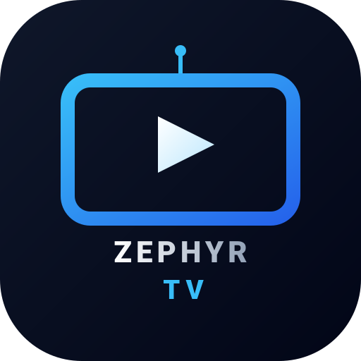

<p align="center"></p>

<h1 align="center">Zephyr TV</h1>

<p align="center">
  <a href="README.md">English</a> · <b>Italiano</b>
</p>

<p align="center">📖 <a href="docs/guida.md"><b>Guida all'uso</b></a>: tutte le funzioni, passo per passo.</p>

<p align="center">
  <em>Leggero come una brezza.</em> Una schermata Home minimale e senza pubblicità che trasforma qualsiasi dispositivo Android (TV, chiavetta, box, telefono o tablet) in una smart TV.
</p>

> [!NOTE]
> **Zephyr TV** (da Zefiro, il vento leggero di ponente) è il nuovo nome di **Piume**, un fork di [**Plume Launcher**](https://github.com/aradhyas8/Plume_Launcher) di [aradhyas8](https://github.com/aradhyas8). Mantiene il design piccolo e veloce di Plume e aggiunge le traduzioni in italiano, spagnolo e francese, film e serie dagli add-on Stremio (Cinemeta, nella tua lingua con TMDB) con un player proprio, utenti con la loro cronologia e Trakt, i canali TV con loghi e programma in onda, una sezione In evidenza di film e serie, i contenuti consigliati per app, la ricerca con filtri, un menu delle sorgenti TV, la modalità notte e il backup delle impostazioni. Zephyr TV si installa accanto a Plume e Piume: ha un suo nome di pacchetto (`link.mccoy88f.zephyr`) e aggiornamenti propri. **Arrivi da Piume?** Installa Zephyr TV: al primo avvio prende da Piume impostazioni, utenti, cronologia e Trakt. Vedi [Riconoscimenti](#riconoscimenti) per tutti coloro sul cui lavoro si basa.

<p align="center">
  <a href="https://github.com/mccoy88f/Zephyr_TV/releases/latest"></a>
  
  
  <a href="LICENSE"></a>
</p>

<p align="center">
  
  
</p>

Zephyr TV sostituisce la Home di serie, piena di elementi, con le due cose che usi davvero: le tue app e quello che stavi guardando. Niente pubblicità, niente righe sponsorizzate, nessun account e nessun tracciamento, e non intralcia le app che apre.

## In breve

- **Qualsiasi dispositivo Android diventa una smart TV.** Un solo APK per Android TV, Google TV, chiavette e box, e anche per telefoni e tablet Android. Col telecomando si muove tutto con le frecce; col dito scorri la Home e le righe, tocchi un'app per le sue righe e di nuovo per aprirla, e trascini in basso per ricaricarle. I pannelli laterali hanno ← e ✕, e quello che una TV fa con un codice QR e il telefono, un telefono o un tablet lo fa da solo.
- **Leggero e veloce.** Un APK da 13 MB (soprattutto il player, il decoder Dolby e DTS e WARP), senza pubblicità, senza account e senza servizi in background aggiuntivi.
- **Un player per ogni schermo.** Media3 riproduce link diretti, HLS, DASH, rtsp://, rtmp:// e udp://, e l'audio Dolby (AC3, E-AC3) e DTS anche su telefoni e tablet. L'episodio dopo parte dopo 10 secondi. Su telefono o tablet: doppio tocco per tornare indietro o andare avanti, scorri per luminosità e volume, pizzica per riempire lo schermo, blocca i comandi e continua a guardare in una finestrella (picture-in-picture).
- **Add-on Stremio, plugin Nuvio ed Estensioni Zephyr.** Film, serie, canali TV, radio e video da tre tipi di sorgenti, in un'unica Home. Plugin ed estensioni girano in processi separati: se uno non risponde, Zephyr TV lo riavvia. Le [Estensioni Zephyr](docs/estensioni.md) sono il formato proprio di Zephyr TV, per esempio [OMG Premium TV](https://github.com/mccoy88f/OMG-Premium-TV) per playlist M3U e account Xtream, e [YouYubeZ](https://github.com/mccoy88f/Zephyr-TV-Extensions/tree/main/youyubez) per la ricerca YouTube (non affiliata a YouTube: riproduzione nell'app YouTube o in Zephyr TV, cookie per le liste dell'account, **Sezioni visibili** da parole chiave). Usano gli oggetti del protocollo degli add-on Stremio e sono scritte in JavaScript, quindi un add-on Stremio o un plugin Nuvio diventa un'estensione con poche modifiche, e si può portare anche la logica di un plugin CloudStream o di un add-on Kodi. Zephyr TV ha già dentro il repository [Zephyr-TV-Extensions](https://github.com/mccoy88f/Zephyr-TV-Extensions): mandate lì la vostra estensione con una pull request (solo contenuti legali) e ogni dispositivo potrà installarla. Le **Opzioni** di un'estensione sono interruttori, scelte, testi dal telefono ed elenchi di elementi che l'utente aggiunge.
- **Radio.** Le stazioni radio compaiono separate dai canali TV e partono subito, con il logo e la canzone in onda.
- **Nascondi il tuo IP con Cloudflare WARP.** Con **WARP per Zephyr TV** attivo, solo Zephyr TV passa dalla rete gratuita WARP di Cloudflare: add-on, plugin e server dei video vedono un indirizzo di Cloudflare, non il tuo. Non serve nessun'altra app.
- **Link e condivisione.** **Condividi** nella pagina di un film, una serie o un episodio manda un link (WhatsApp, Telegram…) che apre la stessa pagina in Zephyr TV su un altro dispositivo. Zephyr TV apre i link `ztv://`, `stremio://` e `nuvio://` e gli indirizzi degli add-on, e aggiunge un add-on solo dopo la tua conferma.
- **Tasto Home su Google TV.** Il tasto Home apre direttamente Zephyr TV, anche sui dispositivi dove il launcher di sistema non si può sostituire. Tenendo premuto Home si apre ancora la dashboard di Google TV.
- **Coda di riproduzione.** Il primo riquadro mostra cosa sta suonando ora in qualsiasi app (Spotify, YouTube…) con copertina e avanzamento, poi **Continua la riproduzione**: riprendi serie e film dalla lista "Guarda dopo" di Android TV e dalle app che pubblicano un proprio canale "Continua a guardare", come Stremio.
- **Sezioni delle app.** Ogni riga che un'app mette in Home (per esempio "Consigliati" e "Tendenze" di YouTube) è una sezione sotto i Preferiti. Tieni premuto OK sull'app e scegli **Sezioni visibili** per sceglierle. L'app TV mostra tutti i canali della TV dal canale 1, una sezione per ogni sintonizzatore, 10 alla volta mentre scorri.
- **Preferiti.** Le tue app come loghi monocromatici (o gli stessi loghi a colori) in una sola riga, con i nomi al focus, sempre o mai. Riordinala tenendo premuto OK, ordinala per uso, o nascondi le app che non usi (restano in Tutte le app). Un PIN facoltativo blocca il layout, così i più piccoli non possono riordinarlo.
- **Ingressi HDMI come app.** Una console o un decoder che si presenta via HDMI-CEC (per esempio "PlayStation 5") ha una sua tessera, che porta la TV su quell'ingresso.
- **Tema chiaro, scuro, Vetro o automatico**, ognuno con il suo sfondo. Vetro mostra lo sfondo attraverso schede lucide e trasparenti, con il testo bianco. Aggiungi le tue foto dal telefono inquadrando un codice QR, oppure mostra una cartella di foto della TV o di una chiavetta USB che cambia a intervalli.
- **In evidenza TMDB, facoltativo.** Film e serie di tendenza, un'altra lista TMDB (popolari, più votati, al cinema, prossime uscite, in onda) o una tua lista pubblica TMDB, sopra i Preferiti, con la loro immagine come sfondo. Cambia titolo ogni pochi secondi, in ordine casuale. I pulsanti aprono il titolo in Nuvio (tramite id TMDB) o Stremio (tramite id IMDb), avviano il trailer su YouTube o aprono un servizio di streaming che lo ha nel tuo paese.
- **Salvaschermo Galleria, facoltativo.** Dipinti di paesaggi di pubblico dominio in 16:9, scaricati solo se lo scegli, una cartella delle tue foto, oppure le immagini di In evidenza con i loro titoli.
- **Meteo facoltativo** sotto l'orologio, e orologio a 12 o 24 ore.
- **Modalità notte.** Nelle ore che scegli la Home diventa più scura e In evidenza si ferma.
- **Canali TV con loghi e programma in onda.** Ogni scheda di canale mostra il logo del canale, dalla TV o altrimenti da [iptv-org](https://github.com/iptv-org/database), e il programma in onda con la barra di avanzamento, da una guida TV in formato XMLTV che scegli tu.
- **Canali TV dagli addon Stremio.** Aggiungi un addon con l'indirizzo del suo manifest (per esempio una configurazione di [OMG+ TV](https://github.com/mccoy88f/OMG-Premium-TV)) in **Impostazioni → Addon Stremio**. I suoi canali compaiono come righe, tutti e poi una per categoria, nell'app TV, in un'app IPTV o in un'app tutta loro. Si guardano nel player di Zephyr TV: CH+ e CH- (o su e giù) cambiano canale, sinistra e destra cambiano stream, OK mostra il programma in onda. Loghi e programmi vengono dall'addon, altrimenti da iptv-org e dalla tua guida TV. L'ultimo canale guardato compare in **Continua la riproduzione**.
- **Film e serie dagli addon Stremio.** Cinemeta, il catalogo di Stremio, riempie le righe delle tessere **Film** e **Serie TV** (oppure ogni addon ha una tessera sua: **Impostazioni → Addon Stremio → Film e serie**). La scheda di un titolo ha **Guarda**, e quella di una serie le stagioni e gli episodi. Zephyr TV chiede gli stream a tutti gli addon che li hanno, avvia il primo che funziona e prova da solo i successivi; il pulsante Stream ne sceglie un altro. Si riproducono solo i link diretti (http, anche indirizzi .php), non i torrent. Sinistra e destra tornano indietro e vanno avanti di 10 secondi, CH+ e CH- passano all'episodio prima e dopo, un episodio finito passa al successivo, e quello che inizi compare in **Continua la riproduzione**, da dove riprende. Anche la ricerca li trova (senza chiave TMDB, nei cataloghi degli addon; con la chiave, **Guarda con gli addon** su un risultato TMDB). Cinemeta è solo in inglese: con la chiave TMDB, titoli, locandine, trame ed episodi arrivano da TMDB nella tua lingua.
- **Ricerca** dalla barra in alto: scrivi con il telecomando, parla, o scrivi dal telefono. Film, serie e canali TV (della TV e degli addon) compaiono in righe separate sotto un riquadro **Risultati** nei Preferiti. OK su un film o una serie mostra descrizione, trailer e app che lo hanno; OK su un canale mostra il programma in onda e **Guarda in TV**.
- **Il telefono come tastiera (su una TV).** Inquadra un codice QR per inviare uno sfondo, scrivere la chiave o la lista TMDB, una ricerca o l'indirizzo della guida TV, salvare un backup delle impostazioni o ripristinarne uno.
- **Stato a colpo d'occhio.** Un pallino rosso sull'icona della rete quando manca internet; un pallino rosso sulle impostazioni di Zephyr TV quando c'è un aggiornamento, e su ogni voce che porta lì.
- **Si aggiorna da solo.** Zephyr TV controlla le sue release su GitHub una volta al giorno e installa le nuove versioni dalle sue impostazioni. Il primo aggiornamento ti chiede di consentire le installazioni da Zephyr TV.

## Immagini

<p align="center">
  
  
</p>

<p align="center">
  
  
  
</p>

## Confronto

Misurato con Plume Launcher 1.3, la versione su cui si basa Zephyr TV, su una Hisense Google TV (Android 12, 1,8 GB di RAM). Zephyr TV aggiunge un player, un decoder Dolby e DTS, le estensioni e WARP: il suo APK è di circa 13 MB, e gli altri valori possono essere un po' più alti:

| | Plume 1.3 | Projectivy Launcher | Launcher di Google TV |
|---|---|---|---|
| Dimensione APK | **1,2 MB** | ~10–14 MB | ~25 MB |
| RAM in uso | **~50–70 MB** | ~65–70 MB | ~93 MB, più un processo di supporto da ~22 MB |
| Servizi in background aggiuntivi | **Nessuno** | 2 | 1 processo sempre attivo |
| Ritorno alla Home da un'app | **~95 ms** | – | – |

## Requisiti

- Qualsiasi dispositivo Android con **Android 7.0 (Nougat) o successivo**: Android TV, Google TV, Fire TV, una chiavetta o un box, un telefono o un tablet (ARM). Su Android 7, **Continua la riproduzione** mostra solo quello che guardi in Zephyr TV e le app non hanno righe proprie: le altre app le pubblicano solo da Android 8. Su telefono o tablet, Zephyr TV ha un'icona tra le app; vedi [Telefoni e tablet](docs/guida.md#telefoni-e-tablet)
- Un modo per installare un APK: l'app *Downloader*, una chiavetta USB con un file manager, oppure `adb`

## Installazione

1. Scarica l'ultimo `ZephyrTV.apk` dalla pagina [Releases](https://github.com/mccoy88f/Zephyr_TV/releases/latest).
2. Installalo sul dispositivo in uno di questi modi (su telefono o tablet, apri il file scaricato):
   - **App Downloader:** inserisci l'indirizzo della pagina qui sopra.
   - **Chiavetta USB:** copia l'APK e aprilo con un file manager.
   - **adb:** `adb install ZephyrTV.apk`
3. Apri **Zephyr TV** dalle tue app. Una configurazione guidata fa sì che il tasto Home lo apra.

### Prima configurazione

Al primo avvio Zephyr TV ti guida per fare in modo che Home lo apra. Per ripeterla, apri **Impostazioni di Zephyr TV → Sistema → Configura il tasto Home**. La stessa sezione ha le due righe che usa:

| Impostazione | Cosa fare |
|---|---|
| **Tasto Home** | Attiva l'interruttore. Nella schermata Accessibilità che si apre, seleziona **Zephyr TV: tasto Home** e attivalo. |
| **Launcher predefinito** | Premi OK e scegli **Zephyr TV** nella finestra. |

Consenti il permesso **programmi TV** quando richiesto: serve a Continua la riproduzione.

> [!NOTE]
> Android mostra lo stesso avviso generico per ogni servizio di accessibilità. Il servizio di Zephyr TV ascolta solo il tasto Home e la comparsa del launcher di sistema. Non può leggere il contenuto dello schermo.

> [!TIP]
> **Android 13 e successivi:** all'inizio Android blocca l'Accessibilità per le app installate fuori dal Play Store. Apri **Impostazioni → App → Zephyr TV**, scegli **Consenti impostazioni con limitazioni** dal menu, poi attiva il servizio.

### Facoltativo: concedi un permesso in più con adb

```sh
adb shell pm grant link.mccoy88f.zephyr android.permission.WRITE_SECURE_SETTINGS
```

Così Zephyr TV può:
- impostare il salvaschermo Galleria dalle sue impostazioni
- riattivare da solo il servizio del tasto Home se l'app viene arrestata

Tutto il resto funziona anche senza.

### Tasto Home su Android 13 e successivi

Android 13 e successivi disattivano l'interruttore di Accessibilità per le app installate fuori dal Play Store, e molte versioni di Google TV nascondono il menu **Consenti impostazioni con limitazioni** che lo sbloccherebbe. Se la configurazione di Zephyr TV arriva al passaggio ADB, sbloccalo una volta da un computer (o da un'app ADB sul telefono) nella stessa rete:

1. Sulla TV apri **Impostazioni → Sistema → Informazioni** e premi sette volte **Build del sistema operativo Android TV** per attivare le Opzioni sviluppatore.
2. In **Impostazioni → Sistema → Opzioni sviluppatore** attiva **Debug di rete** (su alcune TV si chiama **Debug USB**).
3. Esegui questi comandi, con l'indirizzo che mostra Zephyr TV:

   ```sh
   adb connect <indirizzo-tv>:5555
   adb shell pm grant link.mccoy88f.zephyr android.permission.WRITE_SECURE_SETTINGS
   ```

4. Accetta la richiesta di debug sulla TV, poi scegli **Riprova** in Zephyr TV. Zephyr TV attiva da solo il servizio del tasto Home.

## Usare Zephyr TV

| Azione | Come |
|---|---|
| Scegliere le sezioni di un'app in Home | Tieni premuto **OK** sull'app, poi **Sezioni visibili** |
| Passare al tema Vetro | **Impostazioni → Aspetto e sfondi → Tema → Vetro** |
| Riordinare le app | Tieni premuto **OK** su un'app, oppure usa **Impostazioni → Preferiti → Modifica Preferiti** |
| Nascondere un elemento di Continua la riproduzione o della sezione di un'app | Tieni premuto **OK** sulla sua scheda, poi **Rimuovi da questa sezione** |
| Togliere un'app dai Preferiti | Tieni premuto **OK** sull'app, poi **Rimuovi dai Preferiti** (resta in *Tutte le app*) |
| Scegliere le app di Continua la riproduzione | **Impostazioni → Contenuti → App Continua la riproduzione** |
| Mettere un'app di *Tutte le app* in testa alla riga | Apri **Tutte le app** e tieni premuto **OK** sull'app (la rende anche di nuovo visibile) |
| Nascondere app dai Preferiti | **Impostazioni → Preferiti → App nei Preferiti** |
| Mostrare i nomi delle app sempre, al focus o mai | **Impostazioni → Preferiti → Nomi delle app** |
| Passare da icone monocromatiche a colori | **Impostazioni → Preferiti → Stile icone** |
| Aggiornare Zephyr TV | **Impostazioni → Sistema → Aggiornamenti** |
| Bloccare il layout con un PIN | **Impostazioni → Preferiti → Blocco layout** |
| Mostrare film e serie di tendenza in alto (In evidenza TMDB) | **Impostazioni → In evidenza TMDB → API Key TMDB** (scrivila sulla TV o dal telefono) |
| Scegliere cosa mostra In evidenza (tendenze, popolari, più votati, al cinema…) | **Impostazioni → In evidenza TMDB → In evidenza mostra** |
| Mostrare la tua lista TMDB in In evidenza | **Impostazioni → In evidenza TMDB → In evidenza mostra → La mia lista TMDB** |
| Mostrare il programma in onda sotto i canali TV | **Impostazioni → TV e EPG → Guida TV (XMLTV)** |
| Attivare o disattivare i loghi dei canali da iptv-org, o scaricare gli ultimi | **Impostazioni → TV e EPG → Loghi dei canali (iptv-org)**, **Aggiorna i loghi dei canali** |
| Orologio a 12 o 24 ore | **Impostazioni → Aspetto e sfondi → Orologio** |
| Modalità notte | **Impostazioni → Aspetto e sfondi → Modalità notte** |
| Salvare o ripristinare le impostazioni | **Impostazioni → Sistema → Backup e ripristino** |
| Vedere cosa non ha funzionato di recente | **Impostazioni → Sistema → Problemi recenti** |
| Cercare un film, una serie o un canale TV | Il pulsante **cerca** nella barra in alto (tieni premuto OK per l'assistente vocale della TV) |
| Passare a un ingresso HDMI | Il pulsante **Sorgenti TV** nella barra in alto. Un pallino verde indica gli ingressi con un dispositivo collegato: lo stato di Android, o sulle TV Sony quello della TV stessa (verificato su Sony; su altre marche è affidabile quanto lo stato che la TV comunica ad Android) |
| Aprire la dashboard di Google TV | Tieni premuto il tasto **Home** |

### Sfondi personalizzati

Apri **Sfondo tema chiaro** o **Sfondo tema scuro** nelle impostazioni di Zephyr TV e scegli **Aggiungi dal telefono…**. Inquadra il codice QR con il telefono (deve essere nella stessa rete Wi-Fi della TV), scegli una foto e inviala. Diventa subito lo sfondo. La TV la raddrizza, la ritaglia sullo schermo intorno al centro e ne salva una copia ridotta. La pagina di invio funziona solo mentre quella schermata è aperta. **Rimuovi una foto…** nella stessa lista ne elimina una.

Puoi anche copiare tu stesso file `.jpg`, `.png` o `.webp` in `Android/data/link.mccoy88f.zephyr/files/wallpapers/`:

```sh
adb push mio-sfondo.jpg /sdcard/Android/data/link.mccoy88f.zephyr/files/wallpapers/
```

Una leggera dissolvenza viene aggiunta in automatico perché le righe restino leggibili (**Impostazioni → Aspetto e sfondi → Dissolvenza foto** la disattiva).

### Cartelle di foto

Scegli **Scegli una cartella su questa TV…** nella lista degli sfondi per usare un'intera cartella di foto, dalla memoria della TV o da una chiavetta USB. La prima volta Zephyr TV chiede l'accesso alle foto. Le foto si alternano in ordine casuale; **Impostazioni → Aspetto e sfondi → Cambio foto cartella** imposta ogni quanto, da ogni minuto a una volta al giorno. Anche il salvaschermo può mostrare una cartella: **Impostazioni → Salvaschermo → Le tue foto**.

### Blocco layout

**Impostazioni → Preferiti → Blocco layout** imposta un PIN di 4 cifre. Quando è attivo, le impostazioni di Zephyr TV e tutto ciò che cambia la Home (spostare, togliere o fissare app, nascondere serie) chiedono prima il PIN; aprire le app funziona come sempre. Un PIN sblocca le modifiche per cinque minuti, finché non esci dalla Home. Per inserirlo usa le frecce o i tasti numerici del telecomando.

Il blocco protegge il layout, non è un controllo parentale: le app si possono ancora aprire con la ricerca vocale o dalle impostazioni di Android. Hai dimenticato il PIN? **Impostazioni Android → App → Zephyr TV → Cancella dati** lo rimuove, insieme al layout e alle impostazioni.

### In evidenza TMDB

In evidenza ha bisogno di una chiave API TMDB gratuita (chiave v3 o token di lettura v4) da [themoviedb.org](https://www.themoviedb.org/settings/api). Inseriscila in **Impostazioni → In evidenza TMDB → API Key TMDB**, oppure scegli **Inserisci dal telefono…** e inquadra il codice; Zephyr TV verifica la chiave con TMDB. In evidenza mostra poi i titoli di tendenza. **In evidenza mostra** sceglie invece un'altra lista di TMDB: di tendenza questa settimana, i più popolari, i più votati, i film al cinema ora o in uscita nel tuo paese, le serie in onda. **La mia lista TMDB** mostra una lista pubblica che hai creato su themoviedb.org, nel suo ordine: incolla il suo link dal telefono. Si seleziona solo dopo aver impostato una lista.

Ogni titolo ha i pulsanti per Nuvio e Stremio (sempre presenti, se installati), il trailer su YouTube e i servizi di streaming che lo hanno nel tuo paese (**Solo i servizi che hanno il titolo** disattiva questo filtro). In evidenza tiene le immagini sulla TV, quindi ognuna si scarica una sola volta, e si ferma dopo 15 minuti senza che premi un tasto.

### Canali TV e guida TV

La sezione dell'app TV mostra tutti i canali sintonizzati, in ordine di numero. Il logo viene dalla TV oppure, se la TV non lo ha, da [iptv-org](https://github.com/iptv-org/database), un elenco di canali TV di pubblico dominio: Zephyr TV scarica l'elenco del tuo paese la prima volta e poi una volta al mese, abbina i canali per nome e tiene i loghi sulla TV. **Aggiorna i loghi dei canali** scarica subito gli ultimi.

Android lascia leggere la guida programmi della TV solo alle app di sistema, quindi per il programma in onda Zephyr TV usa una guida TV da internet, in formato XMLTV (`.xml` o `.xml.gz`). Inserisci l'indirizzo in **Impostazioni → TV e EPG → Guida TV (XMLTV)**, oppure incollalo dal telefono. Zephyr TV la scarica due volte al giorno e ne tiene il giorno successivo; ogni scheda di canale mostra il programma in onda con la barra di avanzamento, e la pagina di un canale nella ricerca mostra orario, descrizione e programma successivo. Per l'Italia, `https://iptv-epg.org/files/epg-it.xml.gz` copre i canali nazionali.

### Backup e ripristino

**Impostazioni → Sistema → Backup e ripristino** salva le impostazioni sul telefono in un piccolo file, e ne rimanda uno alla TV per ripristinarle. Il backup contiene layout, tema, impostazioni di In evidenza, chiave TMDB e addon Stremio, ma non le foto né il PIN di blocco. Tienilo privato: contiene la chiave TMDB e gli indirizzi dei tuoi addon.

### Salvaschermo Galleria

Seleziona **Impostazioni → Salvaschermo** per passare a Galleria. Zephyr TV scarica i dipinti (4,7 MB) dalle release di Plume Launcher e li conserva in privato. Se torni a un altro salvaschermo vengono eliminati, quindi occupano spazio solo mentre li usi. Con una chiave TMDB puoi scegliere invece **Immagini di In evidenza (TMDB)**: mostra le immagini che In evidenza tiene già sulla TV, con titolo, anno e genere, e non si collega a internet.

## Privacy

Zephyr TV non ha statistiche, pubblicità né account. Si collega a internet solo per:
- caricare le locandine degli elementi di Continua la riproduzione
- controllare le release di questo repository su GitHub, una volta al giorno, e scaricare la nuova versione quando scegli di aggiornare
- scaricare i dipinti della Galleria dalle release di Plume Launcher, **solo se scegli quel salvaschermo**
- ottenere il meteo, **solo se lo attivi**. Trova la tua posizione approssimativa dall'indirizzo IP tramite [ipwho.is](https://ipwho.is), poi ottiene le previsioni da [Open-Meteo](https://open-meteo.com). Una città scelta a mano viene cercata invece con la geocodifica di Open-Meteo.
- mostrare In evidenza TMDB e la ricerca, **solo se inserisci una chiave API TMDB**. Scarica da [TMDB](https://www.themoviedb.org) i titoli della lista che scegli (o della tua), i risultati delle ricerche, i generi, le immagini, i trailer, gli id IMDb e i servizi di streaming.
- scaricare i loghi dei canali TV, **solo per i canali di cui la TV non ha il logo, e se non lo disattivi**: l'elenco dei canali da [iptv-org](https://iptv-org.github.io/api/) una volta al mese, e ogni logo una volta da dove lo indica iptv-org (per lo più Wikimedia e imgur).
- scaricare una guida TV, **solo se ne inserisci l'indirizzo**, due volte al giorno.
- leggere i canali degli addon Stremio **che aggiungi tu**, ogni 15 minuti mentre la home è aperta, e i loro stream, loghi e programmi quando guardi un canale.
- leggere i cataloghi di film e serie di Cinemeta ([v3-cinemeta.strem.io](https://v3-cinemeta.strem.io/manifest.json)) ogni qualche ora quando la tessera Film o Serie TV ha il focus, se non lo disattivi, e la scheda di un titolo quando la apri; e chiedere gli stream di un film agli addon che hai aggiunto quando lo guardi.

Le schermate per il telefono (**Aggiungi dal telefono…**, chiave e lista TMDB, ricerca, indirizzo della guida TV, backup e ripristino) avviano una piccola pagina sulla TV stessa, raggiungibile solo dalla rete di casa, solo mentre quella schermata è aperta e solo a un lungo indirizzo casuale presente nel codice QR. Quello che invii passa direttamente tra telefono e TV, e da nessun'altra parte. Il backup di Android non copia le impostazioni di Zephyr TV.

La Coda di riproduzione mostra cosa sta suonando leggendo le sessioni multimediali di Android, che Zephyr TV vede perché attiva per sé un servizio di accesso alle notifiche (Android lo lascia concedere solo al sistema: esegui una volta `adb shell cmd notification allow_listener link.mccoy88f.zephyr/link.mccoy88f.zephyr.PlayingListener`; **Impostazioni → Contenuti → Mostra cosa sta suonando** dice se è attivo). Non legge nessuna notifica, e quello che stai ascoltando resta sulla TV.

## Risoluzione dei problemi

<details>
<summary><b>Il tasto Home apre ancora la vecchia Home</b></summary>

Controlla che **Impostazioni → Sistema → Tasto Home** sia attivo. Se l'app è stata arrestata, Android spegne il suo servizio di accessibilità; apri Zephyr TV una volta (o concedi il permesso adb facoltativo qui sopra) per ripristinarlo.
</details>

<details>
<summary><b>Continua la riproduzione è vuota</b></summary>

Controlla che il permesso programmi TV sia consentito (**Impostazioni → App → Zephyr TV → Autorizzazioni**) e che l'app che usi pubblichi nella lista "Guarda dopo" di Android TV. Controlla anche **Impostazioni → Contenuti → App Continua la riproduzione** in Zephyr TV.
</details>

<details>
<summary><b>L'opzione del salvaschermo dice che serve un permesso adb</b></summary>

Google TV nasconde i salvaschermi di terze parti dalle sue impostazioni, quindi Zephyr TV ha bisogno del permesso `WRITE_SECURE_SETTINGS` (una sola volta, come sopra) per cambiarlo al posto tuo.
</details>

## Compilare dai sorgenti

```sh
git clone https://github.com/mccoy88f/Zephyr_TV.git
cd Zephyr_TV
./gradlew assembleRelease
```

L'APK viene scritto in `app/build/outputs/apk/release/`. Senza un file `keystore.properties` le build di release sono firmate con la tua chiave di debug locale, che va bene per installare una tua build.

## Contribuire

Segnalazioni di bug, traduzioni e pull request sono benvenute. Zephyr TV resta piccolo di proposito, quindi leggi prima [CONTRIBUTING.md](CONTRIBUTING.md) (in inglese): spiega cosa rientra nel progetto e cosa no, e come inviare una modifica. Apri una issue prima di iniziare una nuova funzione.

## Riconoscimenti

- **[Plume Launcher](https://github.com/aradhyas8/Plume_Launcher)** di [aradhyas8](https://github.com/aradhyas8): il launcher su cui è costruito Zephyr TV, il suo design e gran parte del codice.
- **Piume**, ora **Zephyr TV**, di [mccoy88f](https://github.com/mccoy88f), con l'aiuto di [Claude Code](https://claude.ai/code). La storia di Piume è anche in questo repository; la sua vecchia casa, [Piume_Launcher](https://github.com/mccoy88f/Piume_Launcher), è archiviata.

- **Dipinti del salvaschermo** (pubblico dominio, scansioni da Wikimedia Commons; file in [`screensaver/`](screensaver)):
  - Frederic Edwin Church: *The Heart of the Andes*, *The Icebergs*, *Chimborazo*, *Cotopaxi*
  - Ivan Shishkin: *Rye*
  - Jasper Francis Cropsey: *Autumn on the Hudson River*
  - Martin Johnson Heade: *Thunder Storm on Narragansett Bay*
- **Sfondi:** "Canada" di Thomas Curryer, da [Unsplash](https://unsplash.com/@tawc20) (CC0)
- **Loghi delle app:** [Simple Icons](https://simpleicons.org) (CC0). Tutti i marchi appartengono ai rispettivi proprietari.
- **Loghi dei canali TV:** [iptv-org](https://github.com/iptv-org): il loro [database dei canali](https://github.com/iptv-org/database) (pubblico dominio) tramite le loro [API](https://github.com/iptv-org/api), per i canali di cui la TV non ha il logo. I loghi appartengono ai rispettivi canali.
- **Film e serie:** dati e immagini da [TMDB](https://www.themoviedb.org). Zephyr TV usa le API di TMDB ma non è approvato né certificato da TMDB.

## Licenza

Copyright (C) 2026 aradhyas8 (Plume Launcher)
Copyright (C) 2026 mccoy88f (modifiche di Piume e Zephyr TV)

Zephyr TV è una versione modificata di Plume Launcher. Le modifiche sono elencate in [CHANGELOG.md](CHANGELOG.md) e nella cronologia git. Come Plume Launcher è software libero, rilasciato sotto la [GNU General Public License v3.0](LICENSE). Puoi usarlo, modificarlo e ridistribuirlo, ma ogni versione distribuita, modificata o no, deve essere rilasciata anch'essa sotto GPL-3.0 con il suo codice sorgente completo.
