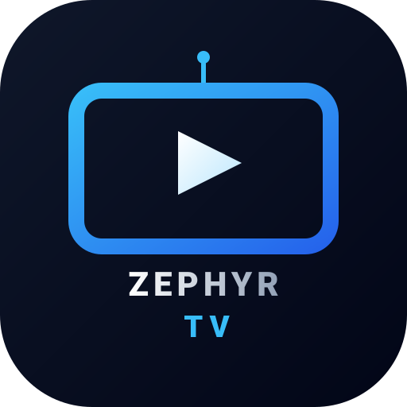

<p align="center"></p>

<h1 align="center">Zephyr TV</h1>

<p align="center">
  <b>English</b> · <a href="README.it.md">Italiano</a>
</p>

<p align="center">📖 <a href="docs/guide.md"><b>User guide</b></a>: every feature, step by step.</p>

<p align="center">
  <em>Light as a breeze.</em> A minimal, ad-free home screen that turns any Android device (TV, stick, box, phone or tablet) into a smart TV.
</p>

> [!NOTE]
> **Zephyr TV** (after Zephyrus, the gentle west wind) is the new name of **Piume**, a fork of [**Plume Launcher**](https://github.com/aradhyas8/Plume_Launcher) by [aradhyas8](https://github.com/aradhyas8). It keeps Plume's small, fast design and adds Italian, Spanish and French translations, films and series from Stremio add-ons (Cinemeta, in your language with TMDB) with their own player, users with their own history and Trakt, TV channels with logos and what's on, a Spotlight of films and series, recommendations per app, search with filters, a TV inputs menu, night mode and settings backup. Zephyr TV installs next to Plume and Piume: it has its own package name (`link.mccoy88f.zephyr`) and its own updates. **Coming from Piume?** Install Zephyr TV: on its first start it takes your settings, users, history and Trakt from Piume. See [Credits](#credits) for everyone whose work it builds on.

<p align="center">
  <a href="https://github.com/mccoy88f/Zephyr_TV/releases/latest"></a>
  
  
  <a href="LICENSE"></a>
</p>

<p align="center">
  
  
</p>

Zephyr TV replaces the cluttered stock home screen with the two things you actually use: your apps and what you were watching. There are no ads, no sponsored rows, no account and no tracking, and it stays out of the way of the apps it launches.

## Highlights

- **Any Android device becomes a smart TV.** One APK for Android TV, Google TV, sticks and boxes, and also for Android phones and tablets. With a remote, everything moves with the arrows; with a finger, swipe the home screen and the rows, tap an app for its rows and again to open it, and pull down to read them again. The side panels have ← and ✕, and what a TV does with a QR code and your phone, a phone or tablet does by itself.
- **Light and fast.** A 13 MB APK (the player, the Dolby and DTS decoder and WARP are most of it), with no ads, no account and no extra background services.
- **A player made for every screen.** Media3 plays direct links (Blu-ray .m2ts files too), HLS, DASH, rtsp://, rtmp:// and udp://, and any sound the device has no decoder for: Dolby (AC3, E-AC3) and DTS on phones and tablets, TrueHD or DTS on TVs without them. The next episode starts after 10 seconds. On a phone or tablet: double-tap to go back or on, swipe for brightness and volume, pinch to fill the screen, lock the controls, and keep watching in a small window (picture-in-picture).
- **Stremio add-ons, Nuvio plugins and Zephyr Extensions.** Films, series, TV channels, radio stations and videos from three kinds of sources, in one home screen. Plugins and extensions run in processes of their own: when one stops responding, Zephyr TV starts it again. [Zephyr Extensions](docs/extensions.md) is Zephyr TV's own format, for example [OMG Premium TV](https://github.com/mccoy88f/OMG-Premium-TV) for M3U playlists and Xtream accounts, and [YouYubeZ](https://github.com/mccoy88f/Zephyr-TV-Extensions/tree/main/youyubez) for YouTube search (not affiliated with YouTube: play in the YouTube app or in Zephyr TV, cookies for account lists, **Visible sections** from keywords). They use the objects of the Stremio add-on protocol and are written in JavaScript, so a Stremio add-on or a Nuvio plugin becomes an extension with little change, and the logic of a CloudStream plugin or a Kodi add-on can be ported too. Zephyr TV has the [Zephyr-TV-Extensions](https://github.com/mccoy88f/Zephyr-TV-Extensions) repository built in: send your extension there with a pull request (legal content only) and every device can install it. An extension's **Options** are switches, choices, texts from your phone, and lists of items the user adds.
- **Radio.** Radio stations show apart from TV channels and play at once, with their logo and the song on air.
- **Hide your IP with Cloudflare WARP.** With **WARP for Zephyr TV** on, only Zephyr TV goes through the free WARP network of Cloudflare: the add-ons, the plugins and the servers of the videos see an address of Cloudflare, not yours. No other app is needed.
- **Links and sharing.** **Share** on the page of a film, series or episode sends a link (WhatsApp, Telegram…) that opens the same page in Zephyr TV on another device. Zephyr TV opens `ztv://`, `stremio://` and `nuvio://` links and the addresses of add-ons, and adds an add-on only after you confirm it.
- **Home button support on Google TV.** The Home button opens Zephyr TV directly, even on devices where the system launcher can't be replaced. Holding Home still opens the Google TV dashboard.
- **Play queue.** The first tile shows what's playing now in any app (Spotify, YouTube…) with its art and progress, then **Continue Playing**: resume shows and films from Android TV's Watch Next list and from apps that publish their own "Continue Watching" channel, such as Stremio.
- **App sections.** Each row an app puts on the home screen (for example YouTube's Recommended and Trending) is its own section under your Favourites. Hold OK on the app and select **Visible sections** to choose them. The TV app shows all the TV's channels from channel 1, one section per tuner, 10 at a time as you move along.
- **Favourites.** Your apps as monochrome logos (or the same logos in brand colour) in a single row, with names on focus, always or never. Rearrange it by holding OK, sort by most used, or hide apps you don't use (they stay in All apps). An optional PIN locks the layout so small hands can't rearrange it.
- **HDMI inputs as apps.** A console or set-top box that names itself over HDMI-CEC (for example "PlayStation 5") gets its own tile, which switches the TV to that input.
- **Light, dark, Glass or automatic theme**, each with its own wallpaper. Glass shows the wallpaper through glossy see-through cards, with white text. Add your own photos from your phone by scanning a QR code, or show a folder of photos from the TV or a USB drive that changes on a timer.
- **Optional TMDB Spotlight.** Trending films and series, another TMDB list (popular, top rated, in cinemas, coming soon, on the air), or your own public TMDB list, above your Favourites, with their backdrop as the wallpaper. It changes title every few seconds, in a random order. Buttons open the title in Nuvio (by TMDB id) or Stremio (by IMDb id), play its YouTube trailer, or open a streaming app that has it in your country.
- **Optional Gallery screensaver.** Public-domain landscape paintings in 16:9, downloaded only if you choose it, a folder of your own photos, or the Spotlight backdrops with their titles.
- **Optional weather** under the clock, and a 12- or 24-hour clock.
- **Night mode.** Between the hours you choose, the home screen goes darker and Spotlight stops.
- **TV channels with logos and what's on.** Each channel card shows the channel's logo, from the TV or else from [iptv-org](https://github.com/iptv-org/database), and the program on now with a progress bar, from a TV guide in XMLTV format that you choose.
- **TV channels from Stremio add-ons.** Add an add-on by its manifest's address (for example an [OMG+ TV](https://github.com/mccoy88f/OMG-Premium-TV) configuration) in **Settings → Stremio add-ons**. Its channels show as rows, all of them and then one per category, in the TV app, in an IPTV app or in an app of their own. They play in Zephyr TV's own player: CH+ and CH- (or Up and Down) change channel, Left and Right change stream, OK shows what's on. Logos and what's on come from the add-on, else from iptv-org and your TV guide. The channel you watched last shows in **Continue Playing**.
- **Films and series from Stremio add-ons.** Cinemeta, Stremio's own catalog, gives the **Films** and **Series** tiles their rows (or each add-on gets a tile of its own: **Settings → Stremio add-ons → Films and series**). A title's page has **Watch**, and a series its seasons and episodes. Zephyr TV asks every add-on that has streams for it, plays the first that works and tries the next by itself; the Stream button picks another. Only direct links play (http, also .php addresses), not torrents. Left and Right go back and on 10 seconds, CH+ and CH- to the episode before and after, an episode that ends goes on to the next, and what you begin shows in **Continue Playing**, where it resumes. Search finds them too (without a TMDB key, in the add-ons' catalogs; with one, **Watch with the add-ons** on a TMDB result). Cinemeta is in English only: with a TMDB key, names, posters, descriptions and episodes come from TMDB in your language.
- **Search** from the top bar: type with the remote, say it, or type on your phone. Films, series and TV channels (the TV's and the add-ons') show in their own rows under a **Results** tile in your Favourites. OK on a film or series shows its description, the trailer and the apps that have it; OK on a channel shows what's on and **Watch on TV**.
- **Your phone as a keyboard (on a TV).** Scan a QR code to send a wallpaper, type the TMDB key or list, a search or the TV guide's address, save a settings backup, or restore one.
- **Status at a glance.** A red dot on the network icon when there's no internet; a red dot on Zephyr TV settings when an update is ready, and on each item that leads to it.
- **Updates itself.** Zephyr TV checks its GitHub releases once a day and installs new versions from its settings. The first update asks you to allow installs from Zephyr TV.

## Screenshots

<p align="center">
  
  
</p>

<p align="center">
  
  
  
</p>

## How it compares

Measured with Plume Launcher 1.3, the version Zephyr TV is based on, on a Hisense Google TV (Android 12, 1.8 GB RAM). Zephyr TV adds a player, a Dolby and DTS decoder, extensions and WARP: its APK is about 13 MB, and its other figures may be a little higher:

| | Plume 1.3 | Projectivy Launcher | Google TV launcher |
|---|---|---|---|
| APK size | **1.2 MB** | ~10–14 MB | ~25 MB |
| RAM while running | **~50–70 MB** | ~65–70 MB | ~93 MB, plus a ~22 MB helper process |
| Extra background services | **None** | 2 | 1 always-on helper |
| Return to home from an app | **~95 ms** | – | – |

## Requirements

- Any Android device running **Android 7.0 (Nougat) or newer**: Android TV, Google TV, Fire TV, a stick or a box, a phone or a tablet (ARM). On Android 7, **Continue Playing** shows only what you watch in Zephyr TV and the apps have no rows of their own: other apps publish those only from Android 8. On a phone or tablet, Zephyr TV has an icon among the apps; see [Phones and tablets](docs/guide.md#phones-and-tablets)
- A way to sideload an APK: the *Downloader* app, a USB drive with a file manager, or `adb`

## Installation

1. Download the latest `ZephyrTV.apk` from the [Releases](https://github.com/mccoy88f/Zephyr_TV/releases/latest) page.
2. Install it on your device, using any of these (on a phone or tablet, open the downloaded file):
   - **Downloader app:** enter the release page address above.
   - **USB drive:** copy the APK over and open it with a file manager.
   - **adb:** `adb install ZephyrTV.apk`
3. Open **Zephyr TV** from your apps. A guided setup makes the Home button open it.

### First-run setup

On first launch Zephyr TV walks you through making Home open it. To run it again, open **Zephyr TV settings → System → Set up Home button**. The same section has the two rows it uses:

| Setting | What to do |
|---|---|
| **Home button** | Turn the switch on. In the Accessibility screen that opens, select **Zephyr TV: Home button** and turn it on. |
| **Default launcher** | Press OK and choose **Zephyr TV** in the dialog. |

Allow the **TV listings** permission when asked; Continue Playing needs it.

> [!NOTE]
> Android shows the same generic warning for every accessibility service. Zephyr TV's service only listens for the Home key and for the system launcher appearing. It cannot read screen content.

> [!TIP]
> **Android 13 and newer:** Android blocks sideloaded apps from Accessibility at first. Open **Settings → Apps → Zephyr TV**, choose **Allow restricted settings** from the menu, then turn the service on.

### Optional: grant one extra permission over adb

```sh
adb shell pm grant link.mccoy88f.zephyr android.permission.WRITE_SECURE_SETTINGS
```

This lets Zephyr TV:
- set the Gallery screensaver from its own settings
- turn its Home button service back on automatically if the app is ever force-stopped

Everything else works without it.

### Home button on Android 13 and newer

Android 13 and newer grey out the Accessibility switch for apps installed outside the Play Store, and most Google TV builds hide the **Allow restricted settings** menu that would unlock it. If Zephyr TV's setup reaches the ADB step, unlock it once from a computer (or a phone ADB app) on the same network:

1. On the TV, open **Settings → System → About** and press **Android TV OS build** seven times to turn on Developer options.
2. In **Settings → System → Developer options**, turn on **Network debugging** (called **USB debugging** on some TVs).
3. Run these, using the address Zephyr TV shows:

   ```sh
   adb connect <tv-address>:5555
   adb shell pm grant link.mccoy88f.zephyr android.permission.WRITE_SECURE_SETTINGS
   ```

4. Accept the debugging prompt on the TV, then choose **Try again** in Zephyr TV. Zephyr TV turns its Home button service on by itself.

## Using Zephyr TV

| Action | How |
|---|---|
| Choose an app's sections on the home screen | Hold **OK** on the app, then **Visible sections** |
| Switch to the Glass theme | **Settings → Appearance & wallpapers → Theme → Glass** |
| Rearrange apps | Hold **OK** on an app, or use **Settings → Favourites → Edit Favourites** |
| Hide an item from Continue Playing or an app's section | Hold **OK** on its card, then **Remove from this section** |
| Remove an app from Favourites | Hold **OK** on it, then **Remove from Favourites** (it stays in *All apps*) |
| Choose which apps feed Continue Playing | **Settings → Content → Continue Playing apps** |
| Pin an app from *All apps* to the front | Open **All apps**, hold **OK** on the app (this also unhides it) |
| Hide apps from Favourites | **Settings → Favourites → Apps in Favourites** |
| Show app names always, on focus or never | **Settings → Favourites → App names** |
| Switch between monochrome and colour icons | **Settings → Favourites → Icon style** |
| Update Zephyr TV | **Settings → System → Updates** |
| Lock the layout with a PIN | **Settings → Favourites → Lock layout** |
| Show trending films and series on top (TMDB Spotlight) | **Settings → TMDB Spotlight → TMDB API Key** (type it on the TV or from your phone) |
| Choose what Spotlight shows (trending, popular, top rated, in cinemas…) | **Settings → TMDB Spotlight → Spotlight shows** |
| Show your own TMDB list in Spotlight | **Settings → TMDB Spotlight → Spotlight shows → My TMDB list** |
| Show what's on under the TV channels | **Settings → TV & EPG → TV guide (XMLTV)** |
| Turn the channel logos from iptv-org on or off, or get the latest | **Settings → TV & EPG → Channel logos (iptv-org)**, **Update the channel logos** |
| Clock in 12 or 24 hours | **Settings → Appearance & wallpapers → Clock** |
| Night mode | **Settings → Appearance & wallpapers → Night mode** |
| Back up or restore your settings | **Settings → System → Backup and restore** |
| See what did not work recently | **Settings → System → Recent problems** |
| Search for a film, a series or a TV channel | The **search** button in the top bar (hold OK on it for the TV's voice assistant) |
| Switch to an HDMI input | The **TV inputs** button in the top bar. A green dot shows the inputs with a device connected: Android's state, or on Sony TVs the TV's own (checked on Sony; on other brands it's as good as what the TV reports to Android) |
| Open the Google TV dashboard | Hold the **Home** button |

### Custom wallpapers

Open **Light mode wallpaper** or **Dark mode wallpaper** in Zephyr TV settings and choose **Add from phone…**. Scan the QR code with your phone (it must be on the same Wi-Fi as the TV), pick a photo and upload it. It becomes the wallpaper straight away. The TV turns it upright, crops it to the screen around its centre and saves a small copy. The upload page only works while that screen is open. **Remove a photo…** in the same list deletes one.

You can also copy `.jpg`, `.png` or `.webp` files to `Android/data/link.mccoy88f.zephyr/files/wallpapers/` yourself:

```sh
adb push my-wallpaper.jpg /sdcard/Android/data/link.mccoy88f.zephyr/files/wallpapers/
```

A gentle fade is added automatically so the rows stay readable (**Settings → Appearance & wallpapers → Photo fade** turns it off).

### Photo folders

Choose **Choose a folder on this TV…** in the wallpaper list to use a whole folder of photos, from the TV's storage or a USB drive. Zephyr TV asks for access to your photos the first time. The photos take turns in shuffled order; **Settings → Appearance & wallpapers → Folder photo changes** sets how often, from every minute to once a day. The screensaver can show a folder too: **Settings → Screensaver → Your photos**.

### Lock layout

**Settings → Favourites → Lock layout** sets a 4-digit PIN. While it's on, Zephyr TV settings and anything that changes the home screen (moving, removing or pinning apps, hiding shows) ask for the PIN first; opening apps works as usual. One PIN unlocks changes for five minutes, until you leave the home screen. Use the arrows or the remote's number keys to enter it.

The lock keeps the layout safe, it isn't parental control: apps can still be opened by voice search or from Android settings. Forgot the PIN? **Android Settings → Apps → Zephyr TV → Clear data** removes it, along with your layout and settings.

### TMDB Spotlight

Spotlight needs a free TMDB API key (v3 key or v4 read token) from [themoviedb.org](https://www.themoviedb.org/settings/api). Enter it in **Settings → TMDB Spotlight → TMDB API Key**, or choose **Enter from your phone** and scan the code; Zephyr TV checks the key with TMDB. Spotlight then shows the trending titles. **Spotlight shows** picks another of TMDB's lists instead: trending this week, popular, top rated, films now in cinemas or coming soon in your country, series on the air. **My TMDB list** shows a public list you made on themoviedb.org, in its own order: paste its link on your phone. It's selected only once a list is set.

Each title has buttons for Nuvio and Stremio (always shown, when installed), its YouTube trailer, and the streaming apps that have it in your country (**Only services that have the title** turns that filter off). Spotlight keeps its images on the TV, so each one downloads only once, and it stops after 15 minutes without a key press.

### TV channels and the TV guide

The TV app's section shows every channel the TV has tuned, in number order. Its logo comes from the TV, or, when the TV has none, from [iptv-org](https://github.com/iptv-org/database), a public-domain list of TV channels: Zephyr TV downloads the list for your country the first time and then once a month, matches the channels by name, and keeps the logos on the TV. **Update the channel logos** gets the latest now.

Android lets only system apps read the TV's own program guide, so for what's on Zephyr TV uses a TV guide from the internet, in XMLTV format (`.xml` or `.xml.gz`). Enter its address in **Settings → TV & EPG → TV guide (XMLTV)**, or paste it on your phone. Zephyr TV downloads it twice a day and keeps the next day of it; each channel card then shows the program on now with a progress bar, and a channel's page in search shows its time, description and what's next. For Italy, `https://iptv-epg.org/files/epg-it.xml.gz` covers the national channels.

### Backup and restore

**Settings → System → Backup and restore** saves your settings to your phone as a small file, and sends one back to restore them. The backup has your layout, theme, Spotlight settings, TMDB key and Stremio add-ons, but not your photos or the lock PIN. Keep it private: it has your TMDB key and your add-ons' addresses.

### Gallery screensaver

Select **Settings → Screensaver** to switch to Gallery. Zephyr TV downloads the paintings (4.7 MB) from Plume Launcher's releases and stores them privately. Switching back to another screensaver deletes them again, so they only take space while you use them. With a TMDB key you can choose **Spotlight trending (TMDB)** instead: it shows the backdrops Spotlight already keeps on the TV, with title, year and genre, and doesn't go online itself.

## Privacy

Zephyr TV has no analytics, no ads and no account. It only connects to the internet to:
- load poster images for your Continue Playing items
- check this repository's GitHub releases for a new version, once a day, and download it when you choose to update
- download the Gallery paintings from Plume Launcher's releases, **only if you choose that screensaver**
- fetch the weather, **only if you turn it on**. It looks up your approximate location from your IP address via [ipwho.is](https://ipwho.is), then gets the forecast from [Open-Meteo](https://open-meteo.com). A city you pick by hand is looked up with Open-Meteo's geocoding instead.
- show TMDB Spotlight and search, **only if you enter a TMDB API key**. It fetches the titles of the list you choose (or your own), search results, their genres, images, trailers, IMDb ids and streaming services from [TMDB](https://www.themoviedb.org).
- download TV channel logos, **only for channels the TV has none for, and unless you turn it off**: the channel list from [iptv-org](https://iptv-org.github.io/api/) once a month, and each logo once from where iptv-org points (mostly Wikimedia and imgur).
- download a TV guide, **only if you enter its address**, twice a day.
- read the channels of the Stremio add-ons **you add**, every 15 minutes while the home screen is open, and their streams, logos and what's on when you watch.
- read Cinemeta's catalogs of films and series ([v3-cinemeta.strem.io](https://v3-cinemeta.strem.io/manifest.json)) every few hours while the Films or Series tile is in focus, unless you turn it off, and a title's page when you open it; and ask the add-ons you added for a film's streams when you play it.

The phone screens (**Add from phone…**, the TMDB key and list, search, the TV guide's address, backup and restore) run a small page on the TV itself, reachable only on your home network, only while that screen is open, and only at a long random address in its QR code. What you send goes straight between your phone and the TV and nowhere else. Android's own backup doesn't copy Zephyr TV's settings.

The Play queue shows what's playing from Android's media sessions, which Zephyr TV can see because it turns on a notification listener for itself (Android lets only the system allow it: run `adb shell cmd notification allow_listener link.mccoy88f.zephyr/link.mccoy88f.zephyr.PlayingListener` once; **Settings → Content → Show what's playing** shows whether it's on). It reads no notifications, and what's playing stays on the TV.

## Troubleshooting

<details>
<summary><b>The Home button still opens the old home screen</b></summary>

Check that **Settings → System → Home button** is on. If the app was force-stopped, Android turns its accessibility service off; open Zephyr TV once (or grant the optional adb permission above) to restore it.
</details>

<details>
<summary><b>Continue Playing is empty</b></summary>

Make sure the TV listings permission is allowed (**Settings → Apps → Zephyr TV → Permissions**), and that the app you watch publishes to Android TV's Watch Next list. Check **Settings → Content → Continue Playing apps** in Zephyr TV too.
</details>

<details>
<summary><b>The screensaver option says it needs an adb permission</b></summary>

Google TV hides third-party screensavers from its own settings, so Zephyr TV needs the one-time `WRITE_SECURE_SETTINGS` grant shown above to switch it for you.
</details>

## Building from source

```sh
git clone https://github.com/mccoy88f/Zephyr_TV.git
cd Zephyr_TV
./gradlew assembleRelease
```

The APK is written to `app/build/outputs/apk/release/`. Without a `keystore.properties` file, release builds are signed with your local debug key, which is fine for installing your own build.

## Contributing

Bug reports, translations and pull requests are welcome. Zephyr TV stays small on purpose, so please read [CONTRIBUTING.md](CONTRIBUTING.md) first: it lists what's in and out of scope and how to send a change. Open an issue before starting on a feature.

## Credits

- **[Plume Launcher](https://github.com/aradhyas8/Plume_Launcher)** by [aradhyas8](https://github.com/aradhyas8): the launcher Zephyr TV is built on, its design and most of its code.
- **Piume**, now **Zephyr TV**, by [mccoy88f](https://github.com/mccoy88f), with help from [Claude Code](https://claude.ai/code). Piume's history is in this repository too; its old home, [Piume_Launcher](https://github.com/mccoy88f/Piume_Launcher), is archived.

- **Screensaver paintings** (public domain, scans via Wikimedia Commons; files in [`screensaver/`](screensaver)):
  - Frederic Edwin Church: *The Heart of the Andes*, *The Icebergs*, *Chimborazo*, *Cotopaxi*
  - Ivan Shishkin: *Rye*
  - Jasper Francis Cropsey: *Autumn on the Hudson River*
  - Martin Johnson Heade: *Thunder Storm on Narragansett Bay*
- **Wallpapers:** "Canada" by Thomas Curryer, via [Unsplash](https://unsplash.com/@tawc20) (CC0)
- **App logos:** [Simple Icons](https://simpleicons.org) (CC0). All trademarks belong to their respective owners.
- **TV channel logos:** [iptv-org](https://github.com/iptv-org): their [channel database](https://github.com/iptv-org/database) (public domain) through their [API](https://github.com/iptv-org/api), for channels the TV has no logo for. The logos belong to their channels.
- **Sound the device has no decoder for** (Dolby and DTS on phones and tablets, TrueHD or DTS on many TVs): [FFmpeg](https://ffmpeg.org), through Jellyfin's [build of the Media3 FFmpeg decoder](https://github.com/jellyfin/jellyfin-androidx-media) (GPL-3.0).
- **Films and series:** data and images from [TMDB](https://www.themoviedb.org). Zephyr TV uses the TMDB API but is not endorsed or certified by TMDB.

## License

Copyright (C) 2026 aradhyas8 (Plume Launcher)
Copyright (C) 2026 mccoy88f (Piume and Zephyr TV changes)

Zephyr TV is a modified version of Plume Launcher. Its changes are listed in [CHANGELOG.md](CHANGELOG.md) and in the git history. Like Plume Launcher, it is free software, released under the [GNU General Public License v3.0](LICENSE). You may use, modify and redistribute it, but any distributed version, modified or not, must also be released under the GPL-3.0 with its full source code.
