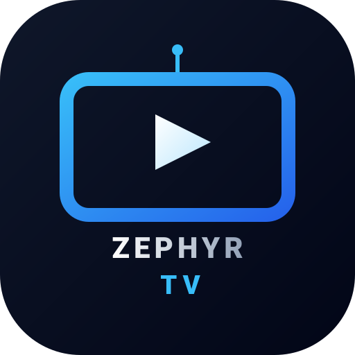

<h1 align="center">Guida di Zephyr TV</h1>

<a href="guide.md">English</a> · <b>Italiano</b>

Questa guida spiega tutte le funzioni di Zephyr TV, dalla prima configurazione alla riproduzione di film, serie e canali. Vale per la versione 3.5 e successive, su una TV, una chiavetta o un box, un telefono o un tablet: [Telefoni e tablet](#telefoni-e-tablet) spiega cosa cambia col dito. Per installare l'app vedi il [README](../README.it.md#installazione).

## Indice

1. [Primo avvio](#1-primo-avvio)
2. [La schermata Home](#2-la-schermata-home)
3. [Usare il telecomando](#3-usare-il-telecomando)
4. [Preferiti e app](#4-preferiti-e-app)
5. [Continua la riproduzione e In riproduzione](#5-continua-la-riproduzione-e-in-riproduzione)
6. [Film e serie](#6-film-e-serie)
7. [La pagina di un titolo](#7-la-pagina-di-un-titolo)
8. [Il player](#8-il-player)
9. [Scegliere gli stream: qualità, lingua, avvio rapido](#9-scegliere-gli-stream-qualità-lingua-avvio-rapido)
10. [Cataloghi dei contenuti](#10-cataloghi-dei-contenuti)
11. [Add-on Stremio](#11-add-on-stremio)
12. [Plugin Nuvio](#12-plugin-nuvio)
13. [Dove compaiono canali, film e contenuti per adulti](#13-dove-compaiono-canali-film-e-contenuti-per-adulti)
14. [Canali TV, guida TV e ingressi](#14-canali-tv-guida-tv-e-ingressi)
15. [Cerca](#15-cerca)
16. [In evidenza](#16-in-evidenza)
17. [Utenti e Trakt](#17-utenti-e-trakt)
18. [Contenuti per adulti e blocco VM18](#18-contenuti-per-adulti-e-blocco-vm18)
19. [Aspetto, sfondi, meteo e notte](#19-aspetto-sfondi-meteo-e-notte)
20. [Salvaschermo](#20-salvaschermo)
21. [Il telefono come tastiera](#21-il-telefono-come-tastiera)
22. [Sistema: tasto Home, aggiornamenti, backup](#22-sistema-tasto-home-aggiornamenti-backup)
- [Telefoni e tablet](#telefoni-e-tablet)
23. [Domande frequenti](#23-domande-frequenti)

---

## 1. Primo avvio

Al primo avvio Zephyr TV fa due domande:

1. **Film e serie**: da quale catalogo arrivano film e serie.
   - **Nuvio Catalog (TMDB)**: titoli, descrizioni e immagini nella lingua del TV, senza bisogno di una chiave.
   - **Cinemeta**: la libreria gratuita di Stremio, in inglese (si può tradurre con TMDB, vedi [In evidenza](#16-in-evidenza)).
2. **Tasto Home**: una procedura guidata fa sì che il tasto Home del telecomando apra Zephyr TV. Segui i passaggi sullo schermo.

Entrambe le scelte si cambiano in seguito: il catalogo in **Impostazioni → Contenuti → Catalogo contenuti**, il tasto Home in **Impostazioni → Sistema → Configura il tasto Home**.

> [!TIP]
> Su Android 13 e successivi, se l'interruttore del tasto Home è grigio, segui il passaggio ADB che Zephyr TV propone. Il [README](../README.it.md#tasto-home-su-android-13-e-successivi) spiega come fare.

## 2. La schermata Home

Dall'alto in basso:

- **Barra in alto**: orologio e meteo, rete, **Utenti**, **Cerca**, **Sorgenti TV** e **Impostazioni**. Un pallino rosso sulla rete indica che manca internet; uno sulle impostazioni, che c'è un aggiornamento.
- **In evidenza** (facoltativo): un film o una serie in grande, che cambia ogni pochi secondi.
- **Preferiti**: la riga delle tue app, con le app virtuali di Zephyr TV (TV, Film, Serie TV…).
- **Sezioni**: sotto i Preferiti, le righe dell'app che ha il focus. Per esempio Continua la riproduzione, le sezioni di YouTube, i canali TV, le righe di film e serie.

## 3. Usare il telecomando

| Tasto | Cosa fa |
|---|---|
| **OK** | Apre l'app, la scheda o la voce selezionata |
| **OK tenuto premuto** | Su un'app: il suo menu (sposta, rimuovi, sezioni visibili). Su una scheda: rimuovila dalla sezione |
| **Indietro** | Chiude il pannello o torna alla pagina precedente, con il focus sulla riga da cui eri partito |
| **Home** | Torna a Zephyr TV. Tenuto premuto apre la dashboard di Google TV |
| **Tasti numerici** | Nel player dei canali: vai al canale. Nei PIN: scrivi le cifre |

## 4. Preferiti e app

**Impostazioni → Preferiti**:

| Voce | A cosa serve |
|---|---|
| **Modifica Preferiti** | Sposta le app nella riga |
| **Ordina app** | Ordine manuale o per uso |
| **App nei Preferiti** | Mostra o nascondi ogni app. Quelle nascoste restano in *Tutte le app* |
| **Posizione dei Preferiti** | A sinistra o al centro |
| **Nomi delle app** | Sempre, solo al focus o mai |
| **Stile icone** | Monocromatiche o a colori |
| **Blocco layout** | Il PIN protegge impostazioni e layout. Le app si aprono comunque. Zephyr TV ha un solo PIN di 4 cifre, per il blocco layout, il blocco VM18 e l'accesso remoto. **Cambia il PIN** chiede il PIN attuale, poi quello nuovo due volte |

Le **app virtuali** di Zephyr TV (TV, Film, Serie TV, Contenuti per adulti, o un'app per ogni add-on) si comportano come le altre app: si spostano, si nascondono e si rimettono.

## 5. Continua la riproduzione e In riproduzione

Il primo riquadro dei Preferiti mostra:

- **In riproduzione**: cosa sta suonando in un'altra app (musica, video), con copertina e avanzamento. Va attivato una volta: **Impostazioni → Contenuti → Mostra cosa sta suonando** spiega come.
- **Continua la riproduzione**: serie e film lasciati a metà, dalle app che li pubblicano e dal player di Zephyr TV, compreso l'episodio successivo di una serie.

| Voce | A cosa serve |
|---|---|
| **App Continua la riproduzione** | Sceglie da quali app arrivano gli elementi |
| **Ripristina elementi nascosti** | Rimette quelli rimossi con OK tenuto premuto |

## 6. Film e serie

Film e serie arrivano dai **cataloghi** ([capitolo 10](#10-cataloghi-dei-contenuti)) e dagli **add-on** che hanno cataloghi. Di base compaiono nelle app virtuali **Film** e **Serie TV**, una riga per catalogo, e la ricerca li trova.

Gli **stream**, cioè i link da riprodurre, arrivano dagli **add-on Stremio** ([capitolo 11](#11-add-on-stremio)) e dai **plugin Nuvio** ([capitolo 12](#12-plugin-nuvio)). Senza nessuno dei due si vedono i titoli ma non si possono riprodurre.

## 7. La pagina di un titolo

OK su una scheda di film o serie apre la sua pagina, a tutto schermo: l'immagine riempie lo schermo; a sinistra ci sono il logo, le informazioni, la descrizione, la regia e il cast; a destra i pulsanti delle azioni:

- **Informazioni**: valutazione, tipo, anno, genere, durata, e se l'hai già visto.
- **Descrizione**: compare subito, prima del resto.
- **Regia e Cast**: il regista e gli attori principali del titolo.
- **Barra delle app**: in fondo a destra, il trailer e le app di streaming che hanno il titolo nel tuo paese (serve la chiave TMDB).
- **Film**: **Guarda** (o **Riprendi da…**) e **Segna come visto**.
- **Serie**: le stagioni, con quanti episodi hai visto. In una stagione, sinistra e destra passano alla stagione accanto. Ogni episodio ha la sua pagina con **Guarda** e **Segna come visto**.

La pagina di un film o di un episodio cerca gli stream quando si apre. **Guarda** mostra **Cerco gli stream…**, poi quanti stream hanno le fonti. Quando premi **Guarda**, il player parte con gli stream già trovati. Con la scelta dello stream automatica, tieni premuto OK su **Guarda** per aprire la lista di tutti gli stream e sceglierne uno. Gli stream trovati restano pronti per 90 secondi; dopo, il player li cerca di nuovo. Gli stream di un canale TV si trovano allo stesso modo, quando resti un momento sulla sua card: un canale fatto di più canali (per esempio HD e SD) li ha tutti pronti.

## 8. Il player

Mentre il player cerca gli stream mostra a che punto è: **Caricamento degli stream disponibili…**, **Verifica delle fonti valide…**, poi **Carico stream 1 di N…**. Se uno stream non funziona passa da solo al successivo.

| Tasto | Film e serie | Canali TV |
|---|---|---|
| **Sinistra / Destra** | Indietro e avanti di 10 secondi (tenuti premuti, più veloce) | Stream precedente e successivo del canale |
| **Su / Giù / OK** | Mostrano il banner | Mostrano il banner |
| **CH+ / CH−**, **⏭ / ⏮** | Episodio successivo e precedente | Canale successivo e precedente |
| **Play / Pausa** | Pausa e ripresa | Pausa e ripresa |
| **OK tenuto premuto**, **Menu** | Audio e sottotitoli | Audio e sottotitoli |

Nel banner ci sono i pulsanti **Episodio precedente**, **Play/Pausa**, **Episodio successivo**, **Audio**, **Sottotitoli** e **Stream**. Quest'ultimo mostra tutti gli stream trovati, raggruppati per qualità dalla più alta, ognuno con la sua fonte, per sceglierne un altro.

- **Serie**: a fine episodio parte il successivo. All'ultimo episodio di una stagione il player chiede se passare alla **stagione successiva**.
- **Audio**: ogni stream parte con l'audio nella lingua del TV, se ce l'ha, altrimenti con la sua traccia principale. La lingua che scegli da **Audio** vale per lo stream che stai guardando.
- **Ripresa**: un film o un episodio lasciato a metà riparte da dove eri, e compare in **Continua la riproduzione**. Riparte con lo stesso stream di prima, senza cercarne altri. Se quello stream non funziona più, il player ne cerca uno nuovo.

## 9. Scegliere gli stream: qualità, lingua, avvio rapido

**Impostazioni → Contenuti**:

| Voce | Predefinito | Cosa fa |
|---|---|---|
| **Scelta dello stream** | Automatica | **Automatica**: il player sceglie e avvia lo stream migliore. **Manuale**: **Guarda** apre **Scegli lo stream**, una lista con gli stream di tutti gli add-on e plugin, ognuno con la sua fonte |
| **Qualità preferita** | Massima | **Massima**, 2160p, 1440p, 1080p, 720p o 480p. Con 1080p, per esempio, il player prova prima 1080p e le qualità più basse, poi quelle più alte. Gli stream 4K restano in lista |
| **Avvio rapido dei contenuti** | Attivo | Parte subito con il primo stream che funziona nella qualità preferita e nella lingua del TV, mentre le altre fonti continuano a cercare. Se nessuna fonte ha quella qualità, aspetta tutte le fonti (fino a 30 secondi) e parte con il migliore del gradino inferiore. Non vale con **Massima**: in quel caso il player aspetta tutte le fonti e sceglie il migliore |
| **Prima gli stream nella lingua del TV** | Attivo | Prova prima gli stream nella lingua del TV, poi quelli senza lingua, per ultimi quelli in altre lingue. Se non ne trova nessuno nella lingua del TV, aspetta tutte le fonti prima di avviarne uno in un'altra lingua |
| **Nascondi stream senza lingua** | Spento | Nasconde gli stream che non dicono in che lingua sono |
| **Nascondi film non ancora usciti** | Spento | Nasconde dallo Spotlight e dalle righe delle app i film non ancora usciti a casa nel tuo paese: ancora solo al cinema, o non ancora usciti. Usa TMDB (serve la chiave). Un film viene nascosto solo quando TMDB lo dice con certezza |
| **Sottotitoli sempre attivi** | Spento | Spento: ogni stream parte senza sottotitoli, tranne quelli che lo stream impone (per esempio una frase in un'altra lingua). Acceso: i sottotitoli nella lingua scelta per ultima, altrimenti in quella del TV. Una scelta fatta nel player vale finché non lo chiudi |
| **Adatta la frequenza dello schermo** | Spento | Porta lo schermo alla frequenza del film (per esempio 24 Hz per un film a 23,976 fps), se il TV ce l'ha: niente scatti nelle panoramiche. Quando il TV cambia modalità lo schermo resta nero per un attimo, e il film aspetta |

Come vengono riconosciute **qualità** e **lingua**:
- **Qualità**: dal nome dello stream, per esempio 2160p/4K/UHD, 1440p/QHD, 1080p/FHD/Full HD, 720p/HD, 480p/SD.
- **Lingua**: dal nome dello stream, per esempio ITA, Italian, SUB-ITA, 🇮🇹, oppure "multi". Se un plugin non lo indica nel nome, vale la lingua dichiarata dal plugin.
- **Controllo**: prima di partire, il player controlla in parallelo tutti gli stream e prova per primi quelli che rispondono davvero con un video. Link scaduti e pagine web vengono saltati.
- **File che nessun player apre**: immagini di dischi (.iso) e archivi (.rar, .zip, .7z) non compaiono tra gli stream.
- **Dolby Vision**: su un TV senza Dolby Vision, i film in Dolby Vision profilo 7 (molti remux 4K) partono in HDR10. Gli stream che dicono solo "DV", senza HDR10, vengono provati dopo gli altri: su quel TV mostrano colori sbagliati.
- **Sottotitoli dagli add-on**: con un add-on di sottotitoli installato (per esempio OpenSubtitles), i suoi sottotitoli nella lingua del TV e in inglese compaiono in **Sottotitoli**, insieme a quelli che un add-on dà con lo stream.

## 10. Cataloghi dei contenuti

**Impostazioni → Contenuti → Catalogo contenuti** è una lista ordinata di cataloghi.

- **Il primo è il principale.** Dà dettagli, descrizioni, immagini e ricerca dei titoli. Se non conosce un titolo, Zephyr TV chiede ai cataloghi successivi.
- **Gli altri** aggiungono le loro righe a Film e Serie TV, nell'ordine della lista. Le copertine dei titoli che il principale conosce sono le sue, anche nelle righe degli add-on e nei risultati della ricerca: un titolo appare uguale ovunque.
- **Selezionando un catalogo** puoi spostarlo su o giù, o rimuoverlo. Ne resta sempre almeno uno.
- **Righe visibili**, nella pagina di un catalogo, elenca le sue righe (per esempio "Film · Popolari"): attiva o disattiva ognuna. Una riga disattivata non compare in Film, in Serie TV né nell'app del catalogo.
- **Aggiungi un catalogo** propone Cinemeta, Nuvio Catalog, i cataloghi usati in passato, oppure un **Nuovo indirizzo** (il manifest di un add-on con cataloghi).

Sotto la lista, le impostazioni TMDB:

| Voce | Cosa fa |
|---|---|
| **Completa con TMDB** | Titoli, descrizioni ed episodi nella lingua del TV, presi da TMDB. Si spegne da solo con Nuvio Catalog, che è già nella tua lingua |
| **API Key TMDB** | La tua chiave gratuita di themoviedb.org. Serve per Completa con TMDB, per la barra delle app e per In evidenza |
| **Lingua / Nazione TMDB** | La lingua dei titoli, che vale anche come lingua del TV per gli stream e per l'audio |
| **Solo i servizi che hanno il titolo** | Nella barra delle app, solo i servizi che hanno davvero il titolo nel tuo paese |
| **App preferite per i suggerimenti** | Quali app compaiono nella barra delle app |

## 11. Add-on Stremio

**Impostazioni → Funzioni aggiuntive → Add-on Stremio**.

- **Aggiungi un add-on**: inquadra il codice QR e incolla l'indirizzo del manifest sul telefono, oppure scrivilo con il telecomando. Si può segnarlo subito come **Contenuti V.M. - Adulti**.
- **Ogni add-on** (con la sua icona) ha una pagina con:
  - **Attivo**: spento, l'add-on resta installato con le sue impostazioni, ma i suoi contenuti non compaiono.
  - **Aggiorna ora**: rilegge subito canali e cataloghi.
  - **Contenuti V.M. - Adulti**: lo segna come per adulti ([capitolo 18](#18-contenuti-per-adulti-e-blocco-vm18)). Un add-on che si dichiara per adulti lo è sempre.
  - **Sposta su / giù**: l'ordine delle sue righe e dei suoi stream.
  - **Rimuovi**.

Un add-on può avere canali TV, cataloghi di film e serie, stream, o solo alcune di queste cose. Zephyr TV usa quello che ha.

## 12. Plugin Nuvio

I plugin Nuvio sono piccoli programmi che trovano da soli gli stream di film, serie e (se lo dichiarano) canali. Zephyr TV li esegue separati da tutto il resto, con accesso solo a internet. **Aggiungi solo repository di cui ti fidi.**

**Impostazioni → Funzioni aggiuntive → Plugin Nuvio**:

- **Aggiungi un repository**: dal telefono (con la casella Contenuti V.M. - Adulti) o con il telecomando. L'indirizzo di solito finisce con `manifest.json`.
- **Ogni repository** ha una pagina con:
  - **Attivo**: tutto il repository, acceso o spento.
  - **Un interruttore per ogni plugin**.
  - **Ordine dei plugin** (con due o più plugin): OK su un plugin per prenderlo, poi OK sul posto dove metterlo. I loro stream vengono chiesti in quest'ordine.
  - **Opzioni disponibili**, sotto i plugin che hanno opzioni proprie: interruttori, scelte da una lista, testi (per esempio un token o un cookie). Sulla voce: **Inserisci dal telefono…** (inquadra il codice) oppure **Scrivilo con il telecomando**.
  - **Contenuti V.M. - Adulti**, **Sposta su / giù**, **Aggiorna ora**, **Rimuovi**.

Le fonti che richiedono WebSocket non sono supportate: un plugin che ne usa una dà comunque gli stream delle altre.

I repository si aggiornano da soli una volta al giorno. I plugin che dichiarano solo lingue diverse da quella del TV non vengono interrogati (con **Prima gli stream nella lingua del TV** attivo).

### Estensioni

Le estensioni sono il formato di Zephyr TV per aggiungere film, serie, canali TV, radio, video e altro. Come i plugin
Nuvio, girano sul TV, separate dal resto e con accesso solo a internet. **Aggiungi solo estensioni di cui ti fidi.**
**OMG Premium TV** è proposta nell'elenco: OK la installa. Nelle sue **Opzioni** aggiungi le tue playlist M3U o i tuoi
account Xtream, e i canali, i film e le serie compaiono nella sua app. C'è anche **YouYubeZ**: ricerca e riproduzione
YouTube in Zephyr TV (non affiliata a YouTube). Nelle sue **Opzioni**: **Riproduci con** (app YouTube, player Zephyr TV,
o entrambi); **Cookie** (incolla dal telefono: **Iscrizioni**, **Guarda dopo** e **Cronologia**); **Sezioni visibili**
(righe di video da parole chiave — **Scopri** e **Tendenze** ci sono già; aggiungine quante ne vuoi).

**Impostazioni → Funzioni aggiuntive → Estensioni Zephyr**:

- **Aggiungi un'estensione**: l'indirizzo del suo `manifest-zephyrtv.json` (o della cartella che lo contiene),
  incollato dal telefono o scritto con il telecomando; oppure il suo file `.zip` inviato dal telefono. Prima di
  installarla Zephyr TV mostra cos'è, chi l'ha scritta e cosa fornisce.
- **Ogni estensione** ha una pagina con **Attivo**, **Opzioni**, **App virtuale** (**Segui il sistema**, **Mostra** o **Nascondi**), **Contenuti V.M. - Adulti**, **Sposta su / giù**,
  **Aggiorna ora** e **Rimuovi**.
- Le **Opzioni** sono quelle dell'estensione: interruttori, una scelta da una lista, un testo (**Inserisci dal telefono…**,
  o scrivilo con il telecomando) e **elenchi** di elementi da aggiungere, modificare, spostare e togliere (un nome e
  delle parole chiave, una playlist, un account). Un cambiamento di **Cookie** o di un elenco di sezioni rilegge le sue righe.
- Dove compare il contenuto lo scegli tu per tipo (**Video**, **Radio**, film…): app virtuale, un'app per add-on, o
  da nessuna parte. **App virtuale** sull'estensione segue quello, oppure mostra o nasconde la sua tile. Senza cataloghi da elencare non ha tile.
- **Controlla aggiornamenti**: Zephyr TV lo fa anche da solo, una volta al giorno.

### Nascondere il tuo IP

Add-on, plugin ed estensioni interrogano i siti dalla tua connessione, quindi quei siti vedono il tuo IP, e lo vede
anche il server di ogni video. **Impostazioni → Funzioni aggiuntive → Nascondi il tuo IP (Cloudflare WARP)**:

- **WARP per Zephyr TV**: tutto quello che fa Zephyr TV (add-on, plugin, estensioni e player) passa dalla rete WARP
  gratuita di Cloudflare, e i siti vedono un suo indirizzo al posto del tuo. Solo Zephyr TV: le altre app restano come
  sono. Android chiede una volta di permettere la VPN e mostra l'icona della chiave finché è attiva; un'altra VPN non
  può essere attiva insieme.
- **Tutto il dispositivo: l'app 1.1.1.1**: l'app di Cloudflare, per WARP su tutte le app.

Alcuni siti rifiutano gli indirizzi delle VPN: se uno smette di funzionare, spegni WARP per un momento.

## 13. Dove compaiono canali, film e contenuti per adulti

**Impostazioni → Funzioni aggiuntive → Virtual App e Integrazioni** (OK cambia l'opzione):

| Voce | Opzioni |
|---|---|
| **Canali TV** | **App TV di sistema** (nell'app TV del televisore, se c'è) · **App virtuale** (un'app TV di Zephyr) · **Un'app per add-on** |
| **Film** | **App virtuale** (l'app Film) · **Un'app per add-on** · **Disattivato** |
| **Serie TV** | **App virtuale** (l'app Serie TV) · **Un'app per add-on** · **Disattivato** |
| **Radio** | **App virtuale** (l'app Radio, con le radio di tutte le estensioni) · **Nell'app di ogni estensione** · **Disattivato** |
| **Contenuti per Adulti** | **App virtuale** (l'app Contenuti per adulti) · **Un'app per add-on** · **Insieme agli altri** |

Quando scegli **App virtuale**, la sua app torna nei Preferiti se l'avevi tolta. Puoi toglierla di nuovo quando vuoi.

## 14. Canali TV, guida TV e ingressi

**Impostazioni → TV e EPG**:

| Voce | Cosa fa |
|---|---|
| **Ingressi TV** | **Menù**: il pulsante **Sorgenti TV** apre un elenco degli ingressi. **Preferiti**: ogni ingresso è un'app |
| **Sorgenti collegate nei Preferiti** | Mette nei Preferiti gli ingressi con un dispositivo collegato (es. una console via HDMI) |
| **Loghi dei canali (iptv-org)** | Loghi per i canali che non ne hanno uno |
| **Aggiorna i loghi dei canali** | Scarica subito gli ultimi loghi |
| **Guida TV (XMLTV)** | Il programma in onda, con la barra di avanzamento. **Automatica** usa la guida del paese della TV da iptv-epg.org. **Un altro paese…** sceglie un'altra guida di iptv-epg.org. **Indirizzo personalizzato…** usa un'altra guida XMLTV, scritta con il telecomando o inviata dal telefono |
| **App TV** | L'app che mostra i canali e li apre. **Automatica** la trova da sola (su Philips l'app Philips). **Altra app…** sceglie qualsiasi app: se non sa aprire un canale (**Solo le righe**), i canali si aprono con l'app automatica |
| **Mostra i numeri dei canali** | I numeri sulle tessere dei canali |
| **Riordina i canali** | I canali nel tuo ordine. Oppure tieni premuto OK su un canale e scegli **Sposta** |

**Player dei canali**: CH+ e CH− cambiano canale, sinistra e destra cambiano stream, OK mostra il programma in onda e il successivo. L'ultimo canale guardato compare in **Continua la riproduzione**.

## 15. Cerca

Il pulsante **Cerca** nella barra in alto (OK tenuto premuto: l'assistente vocale del TV):

- **Cerca**: scrivi con il telecomando, oppure usa il codice QR per scrivere dal telefono.
- **Dillo a voce**: le parole riconosciute compaiono nel campo, poi la ricerca parte da sola.
- **Filtri**:
  - **Tipo di contenuto**: Tutti, Film, Serie TV o Canali TV.
  - **Anno** e **Genere**.
  - **Contenuti per adulti**: Mostra, Non mostrare, Solo contenuti per adulti. Compare solo con il VM18 sbloccato.
  - **Azzera i filtri**.
- **Senza parole**, i filtri da soli mostrano i titoli del catalogo, per esempio "Film · 2010 · Azione".

Il riquadro dei risultati compare subito nei Preferiti, con "Cerco «…»", e si riempie man mano. Indietro, o OK tenuto premuto sul riquadro, chiude la ricerca.

## 16. In evidenza

**Impostazioni → In evidenza** (serve la chiave TMDB, vedi [capitolo 10](#10-cataloghi-dei-contenuti)):

| Voce | Cosa fa |
|---|---|
| **In evidenza mostra** | Di tendenza, popolari, più votati, al cinema, in uscita, in onda, o **La mia lista TMDB** |
| **La mia lista TMDB** | Una tua lista pubblica di themoviedb.org, da incollare dal telefono |
| **Tipo di contenuti** | Film e serie, solo film o solo serie |
| **Titolo successivo ogni** | Ogni quanti secondi cambia il titolo, o mai |

I pulsanti di In evidenza aprono la pagina del titolo, il trailer o un'app di streaming.

## 17. Utenti e Trakt

Il pulsante **Utenti** nella barra in alto (mostra l'iniziale dell'utente in uso) apre un piccolo menu sotto di sé, come **Sorgenti TV**:

- **Scegli un utente**: ognuno ha la sua cronologia, i suoi "visto" e il suo Continua la riproduzione.
- **Impostazioni** (protette dal Blocco layout, se attivo):
  - **Aggiungi utente**, e per ogni utente **Rinomina** e **Rimuovi**.
  - **Collega Trakt**: sincronizza visti e avanzamento con il tuo account Trakt.

## 18. Contenuti per adulti e blocco VM18

- **Add-on e plugin V.M. 18**: segnati a mano, oppure dichiarati tali da loro stessi.
- **Blocco VM18** (menu **Utenti → Impostazioni**, facoltativo): usa il PIN di Zephyr TV. Se non c'è ancora, scegline uno. Quando è bloccato, i contenuti per adulti non compaiono da nessuna parte: app, righe, ricerca, stream.
- **Sblocca VM18** (menu **Utenti**): con il PIN, i contenuti compaiono per **2 ore** oppure, con **Sblocco per → Fino al riblocco**, finché scegli **Blocca VM18**.
- Il blocco torna attivo da solo quando il TV va in **standby**, si spegne o si riavvia.
- **Dove compaiono**: vedi la voce **Contenuti per Adulti** nel [capitolo 13](#13-dove-compaiono-canali-film-e-contenuti-per-adulti).

## 19. Aspetto, sfondi, meteo e notte

**Impostazioni → Aspetto e sfondi**:

| Voce | Cosa fa |
|---|---|
| **Tema** | Chiaro, Scuro, Vetro (schede trasparenti) o Automatico |
| **Sfondo tema chiaro / scuro** | Gli sfondi inclusi, **Aggiungi dal telefono…**, una cartella di foto, o le immagini di In evidenza |
| **Dissolvenza foto** | Una leggera ombra che tiene leggibili le righe |
| **Cambio foto cartella** | Ogni quanto cambia la foto di una cartella |
| **Meteo**, **Unità meteo**, **Località meteo** | Il meteo sotto l'orologio, in °C o °F, per la tua posizione o una città |
| **Orologio** | 12 o 24 ore |
| **Modalità notte**, **Inizio**, **Fine** | Nelle ore scelte la Home si scurisce e In evidenza si ferma |

## 20. Salvaschermo

**Impostazioni → Salvaschermo**:

- **Salvaschermo**: dipinti di paesaggi (scaricati solo se li scegli), una cartella delle tue foto, oppure le immagini di In evidenza con i loro titoli.
- **Prova salvaschermo**: lo avvia subito.
- **Tempi salvaschermo**: apre le impostazioni di Android per scegliere dopo quanto parte.

## 21. Il telefono come tastiera

Molte schermate mostrano un **codice QR**: inquadralo con il telefono, che deve essere nella stessa rete Wi-Fi del TV. Si apre una pagina dove scrivere o incollare (indirizzi di add-on e repository, cookie e altre opzioni, chiave e lista TMDB, guida TV, ricerche) o inviare foto e backup. Sul TV quella pagina è sempre **Inserisci dal telefono…**.

La pagina funziona solo mentre quella schermata è aperta sul TV, e quello che invii va solo dal telefono al TV.

## 22. Sistema: tasto Home, aggiornamenti, backup

**Impostazioni → Sistema**:

| Voce | Cosa fa |
|---|---|
| **Configura il tasto Home** | Ripete la procedura guidata del primo avvio |
| **Tasto Home** | Il servizio che fa aprire Zephyr TV con il tasto Home |
| **Launcher predefinito** | Imposta Zephyr TV come Home di Android |
| **Aggiornamenti** | Cerca e installa le nuove versioni. Si possono ricevere anche le **beta** |
| **Accesso remoto** | Un telefono nella rete di casa cambia le impostazioni, dopo il PIN |
| **Mostra indirizzo accesso** | Il codice da salvare. Compare quando l'accesso remoto è acceso |
| **Backup e ripristino** | Salva le impostazioni sul telefono e le ripristina: anche add-on, plugin Nuvio ed estensioni, con il loro stato e le loro impostazioni. Dopo il ripristino il TV scarica di nuovo le estensioni e i plugin che hanno un indirizzo. Le estensioni installate da un file sono nel backup. Se c'è un PIN, il salvataggio del backup lo chiede prima. Il PIN non è mai nel backup: se il TV aveva un PIN, il ripristino chiede di sceglierne uno nuovo. Il file contiene la chiave TMDB, gli indirizzi degli add-on e gli accessi delle estensioni: tienilo privato |
| **Problemi recenti** | Cosa non ha funzionato di recente. Per uno stream che fallisce: fonte, server e cosa ha risposto |
| **Guida** | Questa guida, sul TV, capitolo per capitolo |
| **Informazioni** | Versione, licenze, fonti dei dati |

## Telefoni e tablet

Zephyr TV funziona anche su telefoni e tablet Android, con il dito:

- **Home**: scorri su e giù, e di lato per scorrere una riga; tocca un'app per vederne le righe e di nuovo per
  aprirla (un'app senza righe si apre subito); tira giù dall'alto per rileggere le righe. Scorri Spotlight per il
  titolo prima o dopo.
- **Pannelli**: ← in alto a sinistra torna alla pagina prima, ✕ in alto a destra li chiude; anche un tocco fuori dal pannello lo chiude.
- **Player**: tocca per le informazioni e i pulsanti; doppio tocco a sinistra o a destra per tornare indietro o
  andare avanti di 10 secondi; trascina la barra di avanzamento; scorri su e giù a sinistra per la luminosità, a
  destra per il volume, al centro per cambiare canale; pizzica per riempire lo schermo o adattarlo; 🔒 blocca i
  comandi; se esci dal player mentre un video va, continua in una finestrella.
- **Condividi** nella pagina di un titolo manda un link: Zephyr TV lo apre su un altro telefono o tablet. Un link
  condiviso con Zephyr TV (il `manifest.json` di un add-on Stremio, un link `stremio://`, `nuvio://` o `ztv://`) viene aggiunto
  dopo la tua conferma.
- Quello che una TV fa con un QR code e il telefono si fa direttamente sul dispositivo: la sua tastiera, il suo
  selettore di file.

## 23. Domande frequenti

<b>Un film dice "Nessuno streaming disponibile"</b>

- Controlla di avere almeno un add-on o un plugin attivo che dia stream (capitoli 11 e 12).
- Con **Prima gli stream nella lingua del TV** attivo, i plugin per altre lingue non vengono interrogati.
- Apri **Sistema → Problemi recenti**: per ogni stream fallito c'è la fonte e cosa ha risposto il server. Link scaduti, pagine web e server bloccati dipendono dalla fonte, non da Zephyr TV.

<b>Parte uno stream in qualità più bassa di quella che vorrei</b>

Con **Avvio rapido** attivo e una qualità preferita, il player parte con il primo stream valido in quella qualità. Con **Massima** aspetta tutte le fonti e sceglie il migliore. Puoi sempre cambiarlo con il pulsante **Stream** del player.

<b>L'audio è in inglese</b>

Ogni stream parte con l'audio nella lingua del TV, se lo stream ce l'ha. Altrimenti scegli la lingua da **Audio** nel player (o tieni premuto OK): vale per lo stream che stai guardando.

<b>Non vedo i contenuti per adulti</b>

Se il **Blocco VM18** è attivo, sbloccalo dal menu **Utenti**. Ricorda che si riattiva da solo con lo standby.

<b>Il tasto Home apre ancora la Home di Google TV</b>

Controlla **Sistema → Tasto Home**. Se l'interruttore è grigio (Android 13+), segui il passaggio ADB della configurazione, spiegato nel [README](../README.it.md#tasto-home-su-android-13-e-successivi).

